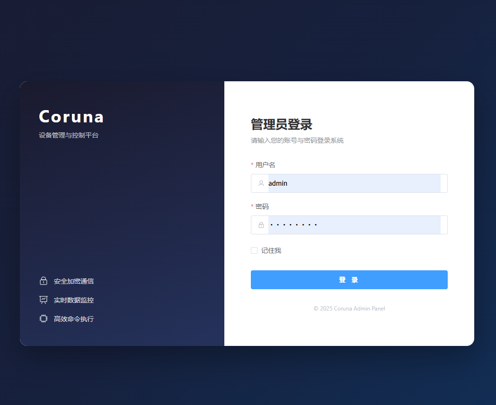
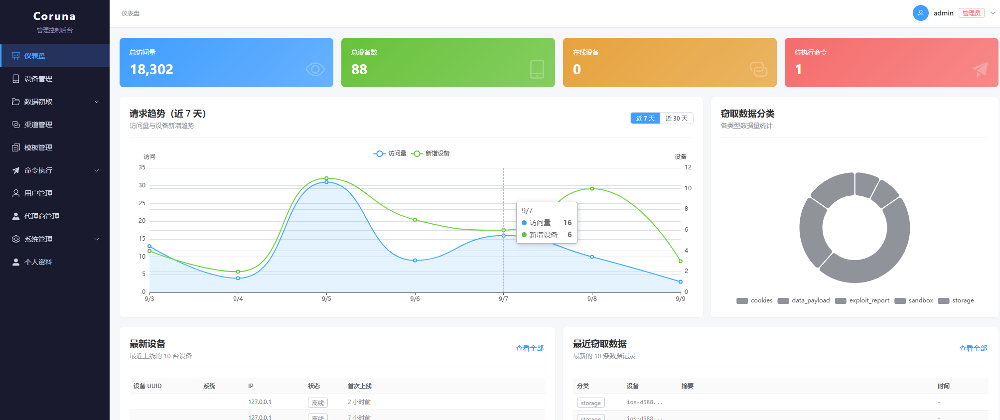
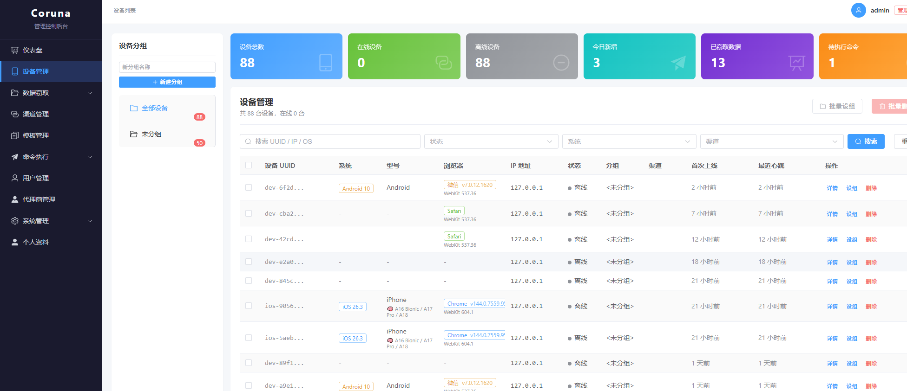

# iOS Admin Panel

ios无感盗U  获取相册项目  联系TG  [@question_05](https://t.me/question_05 )

## 界面预览

### 登录界面

支持账号密码登录与 2FA（TOTP）动态验证码双重验证。



### 仪表盘

设备总览、在线状态、请求趋势、窃取数据分类统计与最新设备/窃取记录。



### 设备管理

设备列表支持按 UUID / IP / OS 搜索，按状态、系统、渠道筛选，支持分组与批量操作。



## 功能模块

- **仪表盘** — 设备统计与数据概览
- **设备管理** — 设备列表、详情、批量操作、分组管理
- **渠道管理** — 渠道 CRUD、密钥轮换、S2S 注册
- **命令管理** — 命令下发、取消、重试、脚本管理
- **模板管理** — 模板 CRUD、预览、种子数据
- **数据窃取** — 通讯录、短信、通话记录、照片、钱包、钥匙串等数据查看
- **钱包管理** — 钱包数据列表与统计
- **系统日志** — 操作日志查询
- **审计日志** — 安全审计记录
- **通知中心** — 实时通知（SSE 推送）
- **系统设置** — C2、利用策略、保留策略、定时任务、认证调优、速率限制、安全设置、水印等
- **用户管理** — 用户 CRUD、密码修改、强制登出、2FA 重置

## 安全特性

- 登录认证 + 可选 2FA（TOTP）双重验证
- 敏感操作 OTP 二次确认
- 会话超时管理
- 模块级 2FA 开关
- 操作审计日志
- 水印防截图

```
├── src/
│   ├── api/            # Axios 实例与 API 模块封装
│   ├── components/     # 公共组件（OTP 对话框等）
│   ├── layouts/        # 布局组件（侧边栏 + 顶栏）
│   ├── router/         # 路由配置
│   ├── stores/         # Pinia 状态管理（auth、app）
│   ├── styles/         # 全局样式
│   ├── views/          # 页面视图
│   │   ├── Audit/      # 审计日志
│   │   ├── Channels/   # 渠道管理
│   │   ├── Commands/   # 命令与脚本
│   │   ├── Devices/    # 设备管理
│   │   ├── Exfil/      # 数据窃取
│   │   ├── Logs/       # 系统日志
│   │   ├── Notifications/ # 通知中心
│   │   ├── Settings/   # 系统设置
│   │   ├── Templates/  # 模板管理
│   │   ├── Users/      # 用户管理
│   │   ├── Wallets/    # 钱包管理
│   │   ├── Dashboard.vue
│   │   └── Login.vue
│   ├── App.vue
│   └── main.ts
├── index.html
├── vite.config.ts
├── tsconfig.json
├── package.json
└── docs/
    └── images/         # README 界面截图
```

## License

Private
